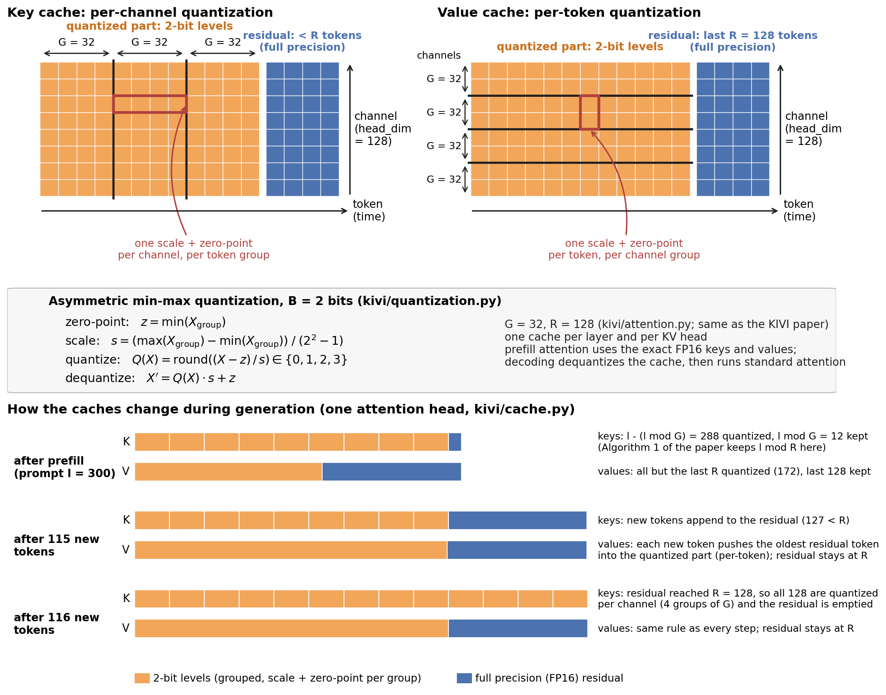
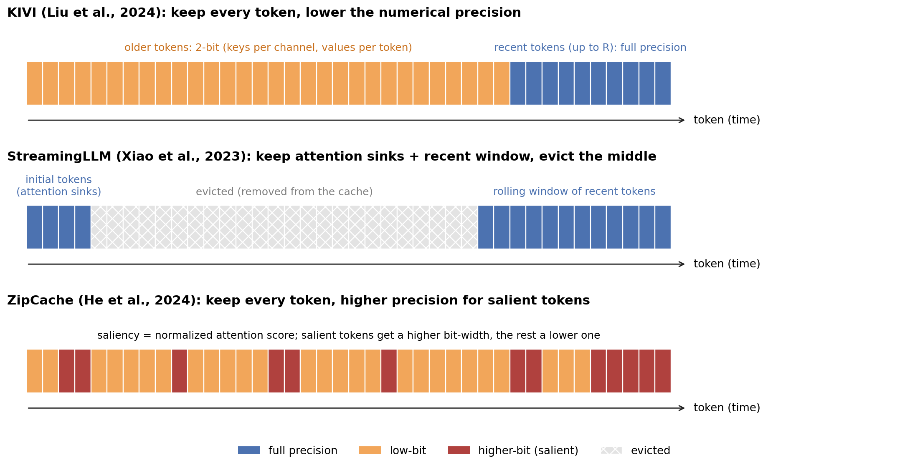
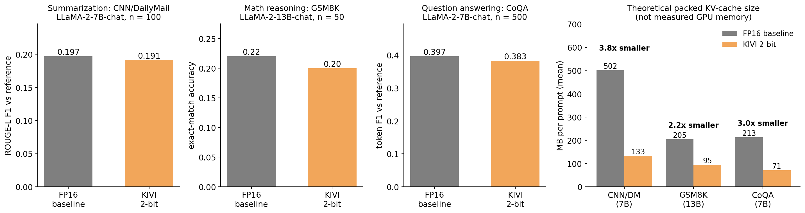
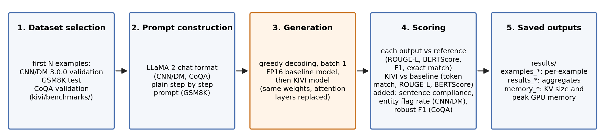

# KIVI: 2-Bit KV-Cache Quantization for LLaMA-2 (7B and 13B)

An implementation of **KIVI** ([Liu et al., 2024, arXiv:2402.02750](https://arxiv.org/abs/2402.02750)), a tuning-free 2-bit quantization of the attention key-value (KV) cache, applied to LLaMA-2-7B-chat and LLaMA-2-13B-chat and evaluated against the FP16 baseline on summarization (CNN/DailyMail), math reasoning (GSM8K) and question answering (CoQA).

This was my part of a team course project on KV-cache optimization (CMSC 723, Graduate NLP, University of Maryland), which I led. Team: Kiyan Amirian, Nicholas Forman, Helia Hosseini, Hengyuan Qi. I implemented and evaluated KIVI; the team report (`report.pdf`) also covers StreamingLLM and a sliding-window cache (Nicholas Forman) and ZipCache (Helia Hosseini).

## How KIVI works (as implemented here)



*KIVI in this repository (`kivi/quantization.py`, `kivi/cache.py`, `kivi/attention.py`), following Liu et al. (2024). Keys are quantized per channel: tokens are grouped G = 32 at a time and each channel of each token group gets its own scale and zero-point. Values are quantized per token: each token's 128-channel head vector is split into groups of G = 32 channels, each with its own scale and zero-point. The most recent tokens stay in full precision. For values this residual is a sliding window of R = 128 tokens; for keys the residual collects new tokens and is quantized all at once when it reaches R = 128. After prefill, this code keeps l mod G prompt keys in full precision, where Algorithm 1 of the paper keeps l mod R. The quantization levels are stored in floating-point tensors (no bit-packing), so memory savings are computed, not measured.*



*KIVI implemented in this repository; StreamingLLM (Nicholas Forman) and ZipCache (Helia Hosseini) implemented by teammates (see report). StreamingLLM (Xiao et al., 2023, [arXiv:2309.17453](https://arxiv.org/abs/2309.17453)) keeps a few initial "attention sink" tokens and a rolling window of recent tokens and evicts the rest. ZipCache (He et al., 2024, [arXiv:2405.14256](https://arxiv.org/abs/2405.14256)) ranks tokens by a normalized attention score and quantizes salient tokens at a higher bit-width than the rest.*

## Results



On all three benchmarks the 2-bit cache scores slightly below the FP16 baseline (ROUGE-L 0.191 vs 0.197, exact match 0.20 vs 0.22, CoQA F1 0.383 vs 0.397), while the theoretical packed KV-cache size is 2.2-3.8 times smaller. The samples are small (50-500 per benchmark), so these differences are indicative only; on GSM8K the gap is one problem out of 50.

| Benchmark (model, samples) | Metric | FP16 baseline | KIVI 2-bit |
|---|---|---|---|
| CNN/DailyMail (7B, 100) | ROUGE-L F1 vs reference | 0.197 | 0.191 |
| | BERTScore F1 vs reference | 0.866 | 0.865 |
| | sentence compliance | 0.797 | 0.753 |
| | entity flag rate | 0.087 | 0.093 |
| | token match rate, KIVI vs baseline | | 0.187 |
| GSM8K (13B, 50) | exact-match accuracy | 0.22 (11/50) | 0.20 (10/50) |
| | token match rate, KIVI vs baseline | | 0.235 |
| CoQA (7B, 500) | token F1 vs reference | 0.397 | 0.383 |
| | robust F1 vs reference | 0.546 | 0.524 |
| | token match rate, KIVI vs baseline | | 0.702 |

Sources: `results/results_cnn_dm_7b_n100.json`, `results/results_gsm8k_13b_n50.json`, `results/results_coqa_7b_n500.json`; the GSM8K counts are from `results/examples_gsm8k_13b_n50.json`.

**Memory.** Two different quantities are saved in `results/memory_*.json`, and they should not be mixed:

* **Theoretical packed KV-cache size** (figure, right panel): the cache size at the end of each generation, counting quantized values at 2 bits, plus the FP16 residual tokens and the FP16 scales and zero-points. Mean per prompt, FP16 vs KIVI: 501.6 vs 133.2 MB (CNN/DM), 205.1 vs 94.7 MB (GSM8K), 212.8 vs 71.2 MB (CoQA). The reduction is well below 16/2 = 8 times because every head keeps up to 128 recent tokens in FP16 and stores an FP16 scale and zero-point for every 32 values, and the prompts here are only a few hundred tokens long.
* **Measured GPU peak memory** (`torch.cuda.max_memory_allocated`): this implementation stores the 2-bit levels in floating-point tensors (no bit-packing) and dequantizes the cache before attention, so it does not reduce measured memory. On CNN/DM the mean per-sample peak is 26,243 MB for the baseline and 26,911 MB for KIVI.

Comparisons with StreamingLLM and ZipCache are in `report.pdf`. They are not repeated here because those methods were run separately by teammates with their own code and settings, and the report's tables combine different sample counts.

## Evaluation



The baseline and KIVI models load the same weights; KIVI replaces every attention layer (`replace_llama_attention_with_kivi`). Both use greedy decoding with batch size 1, and each output is scored against the reference and against the other model's output.

| Benchmark | What it tests | Data | Max new tokens |
|---|---|---|---|
| CNN/DailyMail 3.0.0 | summarizing a long news article in 3 sentences | first 100 validation articles | 256 |
| GSM8K | multi-step math word problems with a numeric answer | first 50 test problems | 256 |
| CoQA | answering a question about a story in a short phrase | first 500 validation questions (the first 32 stories); each question is asked with its story but without the earlier turns of the conversation | 32 |

GSM8K uses the 13B model because the 7B baseline was already weak on it (report, Section 8.2).

Metrics beyond the standard ones (ROUGE-L, BERTScore with RoBERTa-large, CoQA token F1, GSM8K exact match of the last number in the output):

* **Token match rate** (`utils.py`): the fraction of positions at which the KIVI output and the baseline output have the same token, over the length of the shorter output. Added to measure how far quantization moves the output away from the uncompressed model, independent of the reference. It is position by position, so one inserted or dropped token lowers the score for everything after it.
* **Sentence compliance** (CNN/DM): max(0, 1 - |N - 3| / 3), where N is the number of sentences in the summary and 3 is the number requested. Added because some summaries ignored the three-sentence instruction.
* **Entity flag rate** (CNN/DM): the fraction of numbers and capitalized word spans in a summary that do not appear verbatim in the source article. Added as a quick check for names or numbers that are not in the source. It is a heuristic flag, not a measure of factual hallucination: correct paraphrases and capitalized ordinary words can be flagged, and wrong statements built from words in the article are not.
* **Robust F1** (CoQA): token F1 after removing answer prefixes ("the answer is") and mapping yes/no variants to "yes"/"no". Added because raw F1 penalized correct answers wrapped in extra words.

## Repository structure

```
kivi-kv-cache-quantization/
├── kivi/
│   ├── quantization.py, cache.py, attention.py, memory.py
│   └── benchmarks/ (cnn_dm.py, gsm8k.py, coqa.py)
├── utils.py                  JSON helper and token match rate
├── kivi_llama_7b_13b.ipynb   unit tests, memory profiling and the three benchmarks
├── results/                  {examples|memory|results}_{cnn_dm_7b_n100|coqa_7b_n500|gsm8k_13b_n50}.json
├── figures/                  README figures and make_figures.py
├── report.pdf                team report
├── requirements.txt
└── LICENSE
```

## Running

The notebook needs a CUDA GPU and a Hugging Face token with access to the LLaMA-2 weights (`meta-llama/Llama-2-7b-chat-hf`, `meta-llama/Llama-2-13b-chat-hf`).

```bash
pip install -r requirements.txt
```

The pinned transformers version (4.57.6) is the one a CPU smoke test of the KIVI attention passed with; the version used for the saved runs was not recorded.

Then open `kivi_llama_7b_13b.ipynb` in Jupyter from the repository root, so it can import `kivi` and `utils`. The saved CoQA results use 500 questions; the notebook's default is `COQA_SAMPLES = 200`.

The figures are made from the saved results, without a GPU:

```bash
python figures/make_figures.py
```

Notebook reruns write to `results/cnn_dm_kivi_eval/`, `results/coqa_kivi_eval/` and `results/gsm8k_13b_kivi_eval/`; the README tables and figures use the archived files directly in `results/`.

## References

* Zirui Liu, Jiayi Yuan, Hongye Jin, Shaochen (Henry) Zhong, Zhaozhuo Xu, Vladimir Braverman, Beidi Chen, Xia Hu. *KIVI: A Tuning-Free Asymmetric 2bit Quantization for KV Cache.* ICML 2024. [arXiv:2402.02750](https://arxiv.org/abs/2402.02750), [official code](https://github.com/jy-yuan/KIVI)
* Guangxuan Xiao, Yuandong Tian, Beidi Chen, Song Han, Mike Lewis. *Efficient Streaming Language Models with Attention Sinks.* ICLR 2024. [arXiv:2309.17453](https://arxiv.org/abs/2309.17453)
* Yefei He, Luoming Zhang, Weijia Wu, Jing Liu, Hong Zhou, Bohan Zhuang. *ZipCache: Accurate and Efficient KV Cache Quantization with Salient Token Identification.* NeurIPS 2024. [arXiv:2405.14256](https://arxiv.org/abs/2405.14256)
